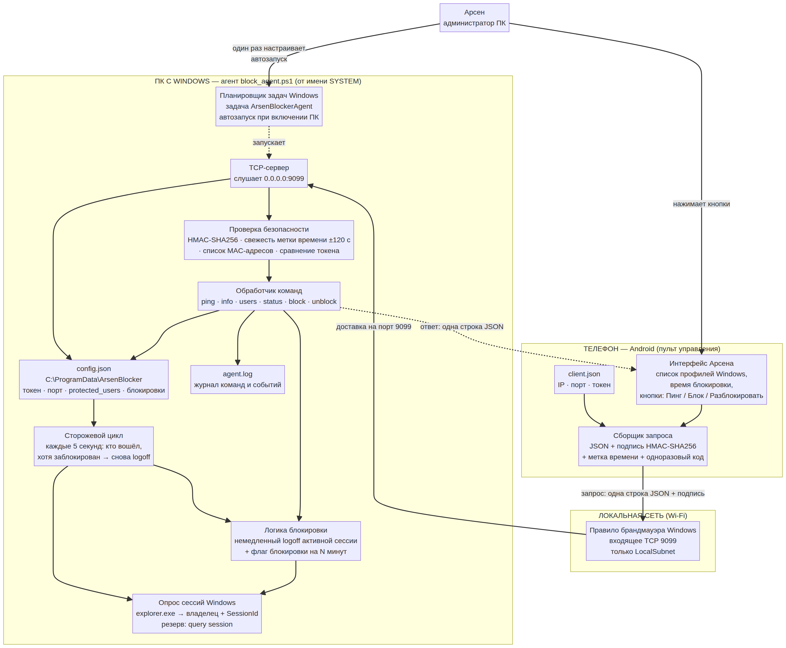
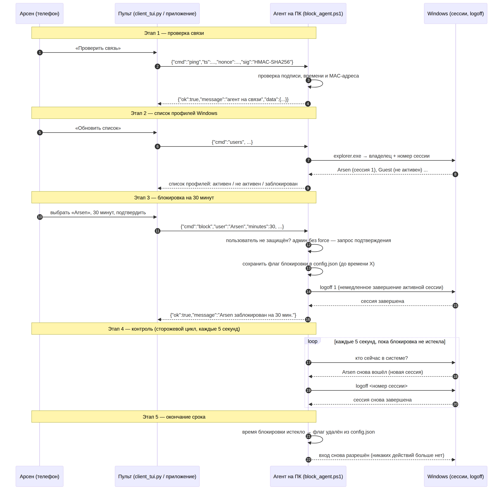

# ArsenBlocker — система удалённой блокировки учётных записей Windows с телефона

**Архитектура, протокол, код и пошаговые инструкции**
Версия 1.0.0 · протокол `v1` · для Арсена (сделано так, чтобы не требовалось программировать)

---

## 0. Коротко: что это такое

Система состоит из двух частей, которые общаются по вашей домашней сети (Wi-Fi):

| Часть | Где работает | Что делает | Файл |
|---|---|---|---|
| **Агент** («сервер») | Ваш ПК с Windows, фоном, с правами администратора | Слушает порт 9099, принимает команды, **сразу выкидывает** выбранного пользователя из системы и **не даёт ему войти** N минут | `windows/block_agent.ps1` |
| **Пульт** («клиент») | Телефон на Android | Показывает профили Windows, кнопки «Заблокировать на N минут», «Разблокировать», «Пинг» | `python/client_tui.py` (Termux), `python/client_gui.py` (Pydroid 3) или `android/MainActivity.kt` (своё приложение) |

Ключевая идея: пользователя **никто не удаляет и не отключает**. Агент:

1. по команде `block` **немедленно завершает активный сеанс** (`logoff`) и запоминает флаг блокировки;
2. каждые 5 секунд проверяет, кто сейчас в системе, и **снова завершает сеанс**, если это заблокированный пользователь;
3. по истечении срока флаг удаляется — вход снова разрешён автоматически.

При этом **все занимаемые места** — это обычные текстовые файлы, которые можно править в блокноте, а настройки лежат в отдельной папке, поэтому **они сохраняются при переустановке программы** (подробно в разделе 9).

---

## 1. Схема архитектуры



Как читать эту схему:

* **Слева-внизу** — ПК с Windows. При включении компьютера Планировщик задач запускает агент от имени `SYSTEM` (у этой служебной учётной записи есть права администратора, поэтому Windows разрешает ей завершать чужие сеансы).
* **Внутри агента** идут четыре независимых процесса:
  * *TCP-сервер* — принимает запросы;
  * *проверка безопасности* — HMAC-подпись, свежесть времени, при желании MAC-адрес телефона;
  * *обработчик команд* — `ping / info / users / status / block / unblock`;
  * *сторожевой цикл* — каждые 5 секунд заново выкидывает тех, кто в блокировке (это и есть «запрет входа» вместо удаления учётной записи).
* **Справа** — телефон. Пульт сам подписывает каждый запрос и отправляет **одну строку JSON** на ПК; в ответ приходит **одна строка JSON**.
* **Вверху** — ваши действия: один раз настроить автозапуск, потом просто нажимать кнопки.

### 1.1. Что происходит по шагам при блокировке



---

## 2. Протокол обмена (v1)

### 2.1. Транспорт

* TCP, порт по умолчанию **9099** (меняется в `config.json` → `listen_port`).
* Один запрос — одна строка JSON, завершённая символом перевода строки. Ответ — тоже одна строка JSON.
* Кодировка UTF-8 (поэтому русские логины и имена работают).

### 2.2. Формат запроса (телефон → ПК)

```json
{
  "cmd": "block",
  "user": "Arsen",
  "minutes": 30,
  "ts": 1760030400,
  "nonce": "9f3a1c77b20e5d41",
  "sig": "a7f1...64 шестнадцатеричных символа..."
}
```

| Поле | Обязательно | Что означает |
|---|---|---|
| `cmd` | да | Команда: `ping`, `info`, `users`, `status`, `block`, `unblock` |
| `user` | для `block`/`unblock` | Логин Windows без имени компьютера, например `Arsen`. Для `unblock` можно передать `*` — снять все блокировки |
| `minutes` | для `block` | Длительность блокировки в минутах (целое число > 0) |
| `ts` | да (режим `hmac`) | Время отправки, секунды Unix (сколько всего секунд прошло с начала эпохи) |
| `nonce` | да (режим `hmac`) | Случайные 16 символов — защита от повторной отправки перехваченного запроса |
| `sig` | да (режим `hmac`) | Подпись запроса, шестнадцатеричная строка |
| `token` | да (режим `token`) | Простой токен вместо подписи — менее безопасный вариант |
| `force` | нет | `true` — подтверждение блокировки администратора (см. 4.6) |

### 2.3. Как считается подпись (главное правило системы)

Из полей собирается строка по строгому шаблону — **на телефоне и на ПК она формируется одинаково**:

```
v1|команда|пользователь|минуты|метка_времени|одноразовый_код
```

Пример: `v1|block|Arsen|30|1760030400|9f3a1c77b20e5d41`

Затем:

```
sig = HMAC-SHA256(ключ = ваш токен, данные = собранная строка)   → шестнадцатеричная строка
```

ПК повторяет те же вычисления у себя и сравнивает результат. Совпало — команда выполняется. Не совпало — отказ, и в журнал пишется причина.

Пример правильно подписанного запроса на блокировку:

```
{"cmd":"block","user":"Arsen","minutes":30,"ts":1760030400,"nonce":"9f3a1c77b20e5d41","sig":"6b0b4f6d..."}
```

Токен **никогда не передаётся по сети** — по сети идёт только подпись, поэтому перехватить его нельзя.
(Режим `token` оставлен для простоты: он передаёт токен как есть и подходит только для полностью доверенной домашней сети.)

### 2.4. Формат ответа (ПК → телефон)

```json
{"ok": true,  "message": "Пользователь 'Arsen' заблокирован на 30 мин. Завершено активных сессий: 1."}
{"ok": false, "message": "отказ в доступе: подпись запроса не совпадает (проверьте токен)"}
{"ok": true,  "message": "список пользователей", "data": {"users": [ ... ]}}
{"ok": false, "message": "Пользователь 'Arsen' — администратор. Повторите с подтверждением (force=true).", "need_force": true}
```

| Команда | Что вернёт |
|---|---|
| `ping` | `ok`, имя компьютера, версия агента, время. Самый быстрый тест связи |
| `info` | версия, порт, режим защиты, интервал проверки, максимум блокировки, список защищённых пользователей, время работы агента |
| `users` | **список профилей Windows**: логин, имя, активен ли сейчас, номер сеанса, остаток блокировки |
| `status` | активные блокировки (до какого времени и сколько осталось) + список активных сеансов |
| `block` | результат блокировки: сколько сеансов закрыто |
| `unblock` | снятие блокировки с одного пользователя или со всех (`*`) |

Пример ответа на `users` (его показывает пульт):

```json
{"ok":true,"message":"список пользователей","data":{"users":[
  {"user":"Arsen","display":"HOME-PC\\Arsen","sid":"S-1-5-21-...","loaded":true,
   "active":true,"session_id":1,"blocked_until":null,"remaining_min":0},
  {"user":"Guest","display":"HOME-PC\\Guest","sid":"S-1-5-21-...","loaded":false,
   "active":false,"session_id":null,"blocked_until":1760032200,"remaining_min":12}
]}}
```

---

## 3. Как именно работает блокировка (без удаления пользователя)

### 3.1. Как агент узнаёт, кто «в системе»

Два независимых способа, объединённых вместе:

1. **Основной (не зависит от языка Windows).** Ищутся процессы `explorer.exe` (рабочий стол), у каждого запрашивается владелец и **номер сеанса**:

   ```powershell
   Get-CimInstance Win32_Process -Filter "Name = 'explorer.exe'" | ForEach-Object {
       Invoke-CimMethod -InputObject $_ -MethodName GetOwner   # кто владелец
       # и номер сеанса:$_.SessionId
   }
   ```

2. **Резервный.** Разбирается вывод команды `query session` — на случай подключений по удалённому рабочему столу (RDP), где рабочего стола может не быть.

Такой подход выбран специально: русская и английская Windows выводят `query session` и `quser` с разными словами (Активен/Active, ИМЯ ПОЛЬЗОВАТЕЛЯ/USERNAME), а разбор по позициям в строке ломается. Работа с владельцем процесса и номером сеанса работает одинаково на любом языке.

### 3.2. Как агент завершает сеанс

Используется штатная команда Windows `logoff`:

```powershell
logoff.exe 1            # по НОМЕРУ сеанса — надёжнее, не зависит от языка
logoff.exe Arsen        # резервный вариант — по имени пользователя
```

Это ровно то же, что делает кнопка «Завершить сеанс» в диспетчере задач. Сеанс `0` (служебный) агент **никогда** не закрывает.

### 3.3. Сторожевой цикл — «запрет входа»

Windows не имеет штатного способа «запретить вход на 40 минут, но не удалять пользователя», поэтому применяется подход «выкидывать каждый раз, когда войдёт»:

```
каждые 5 секунд:
    удалить истёкшие блокировки из config.json
    если есть активные блокировки:
        для каждого, кто сейчас в системе:
            если он в блокировке → logoff
```

* Флаг блокировки хранится в `config.json` (ключ `blocked`) **вместе с временем окончания**, поэтому блокировка **переживает перезагрузку ПК и перезапуск агента**.
* Интервал проверки настраивается: `check_interval_seconds` (по умолчанию 5 секунд). Меньше — реакция быстрее, но чаще обращения к системе.

### 3.4. Честно о пределах возможностей

Важно понимать ограничения (они принципиальные, а не «недоделки»):

| Ситуация | Что произойдёт |
|---|---|
| Заблокированный пользователь вошёл заново | Сеанс закроется в течение интервала проверки (по умолчанию — до 5 секунд он может успеть увидеть рабочий стол) |
| Пользователь не вошёл ни разу | Ничего не нужно делать — вход «не запрещён», просто при попытке входа сеанс закроют |
| Пользователь на экране входа | Он сможет ввести пароль и увидеть рабочий стол на несколько секунд, затем его выкинет. Это и есть «временная блокировка» в мягком варианте |
| Нужно, чтобы войти было **вообще** невозможно | Смотрите «Усиленный режим» ниже — он жёстче и одновременно опаснее |
| Агент выключен/остановлен | Блокировка не действует, а сами флаги остаются в `config.json` до истечения срока |

> **Усиленный режим (по желанию, по умолчанию выключен).**
> Если нужно, чтобы войти было невозможно в принципе, можно на время блокировки **отключать учётную запись** (`net user Arsen /active:no`) и включать обратно при истечении срока.
> Плюс: вход невозможен вообще. Минус: если агент упадёт или ПК выключится в момент блокировки, учётная запись останется отключённой, и придётся включать её вручную.
> Поэтому в базовой версии используется мягкий, но безопасный вариант с `logoff`. Усиленный режим описан в конце документа как возможное развитие (`net user /active:no` в разделе 13).

---

## 4. Безопасность

### 4.1. Токен доступа

При первом запуске агент **сам создаёт случайный 48-символьный токен** (`security.token`) и печатает его в конце работы установщика и в журнал. Этот токен вводится на телефоне один раз и хранится в `client.json`.

* Токен лежит в `C:\ProgramData\ArsenBlocker\config.json`, к которому **доступ есть только у SYSTEM и Администраторов** (установщик закрывает права).
* В режиме `hmac` токен по сети не передаётся.

### 4.2. Подпись HMAC-SHA256

Каждый запрос подписывается — см. раздел 2.3. Перехваченный запрос нельзя подделать (нельзя поменять пользователя или время блокировки) и нельзя повторить «как есть» дольше, чем действительна метка времени.

### 4.3. Метка времени и одноразовый код (nonce)

* ПК принимает запросы только если часы телефона и ПК расходятся не более чем на `max_clock_skew_seconds` (по умолчанию 120 секунд). Поэтому важно, чтобы на телефоне было включено «автоматическое определение времени».
* Если часы расходятся сильнее, пульт получит понятное сообщение с точной величиной расхождения.

### 4.4. Ограничение по MAC-адресу телефона (необязательно)

В `config.json` → `security.allowed_macs` можно указать MAC-адрес телефона:

```json
"allowed_macs": ["A4:5E:60:12:34:56"]
```

Если список пуст — разрешено с любого устройства (но всё равно нужен токен). Как узнать MAC телефона в Termux: команда `ip link show wlan0` (строка `link/ether A4:5E:60:12:34:56`).

### 4.5. Ограничение по сети

* Установщик создаёт правило брандмауэра: входящее TCP 9099 **только из локальной сети** (`LocalSubnet`).
* Порт в интернет **не выставляется**. Для управления извне (через мобильный интернет) правильный путь — VPN между телефоном и ПК (WireGuard / Tailscale): тогда трафик шифруется, и порт остаётся закрытым для всего остального интернета.

### 4.6. Защита от блокировки самого себя

* `protected_users` — список логинов, которые агент **никогда** не блокирует (`Administrator`, `Администратор`, `SYSTEM`, `Гость`…).
* `protect_admins: true` — если вы всё-таки решили заблокировать администратора, пульт сначала спросит подтверждение и отправит второй запрос с полем `force: true`. Случайно «выкинуть» Арсена с его же ПК одной кнопкой не получится.
* `max_block_minutes` (по умолчанию 1440 = сутки) — ограничение сверху, чтобы опечатка вида «999999» не заблокировала ПК на годы.

### 4.7. Журнал

`C:\ProgramData\ArsenBlocker\agent.log` — все события: запуск, IP-адрес и MAC каждого клиента, какая команда, какой результат, причины отказов, закрытые сеансы. Журнал ротируется (старый переименовывается в `agent.log.1`) при размере больше 5 МБ.

> **Юридически и по-человечески.** Система предназначена для администрирования **собственного ПК**. Скрытая слежка и удалённое управление чужими устройствами без согласия владельца — это уже другая история, и такие действия незаконны. Здесь всё прозрачно: агент пишет журнал, показывает свои IP-адреса и не скрывается от пользователя компьютера.

---

## 5. Состав проекта (что в какой папке лежит)

```
arsen_blocker/
├─ ARCHITECTURE.md              ← этот документ
├─ README.md                    ← короткая памятка (с чего начать)
├─ windows/
│  ├─ block_agent.ps1           ← АГЕНТ (сервер) для ПК. Главный файл Windows-части
│  └─ install_agent.ps1         ← УСТАНОВЩИК: автозапуск, брандмауэр, права, токен
├─ python/
│  ├─ client_tui.py             ← пульт для Termux (текстовые команды и меню)
│  └─ client_gui.py             ← пульт с окнами и кнопками (Pydroid 3, Windows)
├─ android/
│  ├─ MainActivity.kt           ← вариант «своё приложение» (Kotlin, Android Studio)
│  ├─ AndroidManifest_snippet.xml
│  └─ build_gradle_snippet.txt
├─ docs/
│  ├─ config.example.json       ← пример настроек агента
│  └─ client.example.json       ← пример настроек пульта
├─ tests/
│  ├─ mock_agent.py             ← «тренажёр» агента на Python (проверить пульт без Windows)
│  ├─ test_client.py            ← автотест пульта (16 проверок)
│  ├─ make_request.py           ← формирует подписанный запрос для тестов
│  └─ test_protocol.ps1         ← автотест агента и совместимости подписи (20 проверок)
└─ diagrams/
   ├─ architecture.png / .mmd   ← схема системы
   └─ sequence.png / .mmd       ← схема последовательности блокировки
```
---

## 6. Установка на Windows: пошагово

Понадобится 10–15 минут. Ничего компилировать не нужно — это скрипт PowerShell.

### Шаг 1. Положите файлы на ПК

Создайте папку, например `C:\ArsenBlocker`, и скопируйте туда два файла:

* `block_agent.ps1` — сам агент;
* `install_agent.ps1` — установщик.

Оба файла должны лежать **рядом** (установщик ищет агента по соседству).

### Шаг 2. Разрешите запуск скриптов

Откройте **PowerShell от имени администратора**:
Пуск → напишите `PowerShell` → правой кнопкой → **«Запуск от имени администратора»**.

Выполните один раз:

```powershell
Set-ExecutionPolicy -Scope LocalMachine -ExecutionPolicy RemoteSigned -Force
```

### Шаг 3. Запустите установщик

В том же окне (не забудьте перейти в папку с файлами):

```powershell
cd C:\ArsenBlocker
powershell.exe -NoProfile -ExecutionPolicy Bypass -File .\install_agent.ps1
```

Если хотите свой порт и свои MAC-адреса телефонов:

```powershell
.\install_agent.ps1 -Port 9099 -AllowMac "A4:5E:60:12:34:56"
```

### Шаг 4. Что сделает установщик (и что вы должны увидеть)

1. Проверит права администратора (без них остановится с понятным сообщением).
2. Создаст папку `C:\ProgramData\ArsenBlocker`.
3. Скопирует туда `block_agent.ps1`.
4. Закроет права на папку (там токен) — читать смогут только SYSTEM и Администраторы.
5. Создаст правило брандмауэра: входящее TCP 9099 только из локальной сети.
6. Создаст задачу `ArsenBlockerAgent` в Планировщике задач: запуск при включении ПК, от имени `SYSTEM`, скрыто, с автоперезапуском при сбое.
7. Запустит агента сразу и покажет экран с итогом:

```
==========================================================
 ГОТОВО. Что ввести в приложении на телефоне:
==========================================================
 ТОКЕН  : 3f9c2b7e14d05a8c6b1e9327fa4d0c58e7a1b6d9c2f0e4a7
 ПОРТ   : 9099
 РЕЖИМ  : hmac

 IP-АДРЕС ЭТОГО ПК:
   192.168.1.50   (Ethernet)
```

**Запишите ТОКЕН и IP** — они нужны телефону.

### Шаг 5. Проверьте, что агент работает

```powershell
# Задача запущена?
Get-ScheduledTask -TaskName ArsenBlockerAgent | Get-ScheduledTaskInfo

# Что в журнале (последние строки, в реальном времени)?
Get-Content "C:\ProgramData\ArsenBlocker\agent.log" -Tail 20
Get-Content "C:\ProgramData\ArsenBlocker\agent.log" -Wait   # Ctrl+C для остановки
```

В журнале должно быть примерно так:

```
2026-10-10 21:20:03 [INFO] === Агент ArsenBlocker v1.0.0 запущен. Порт: 9099 ===
2026-10-10 21:20:03 [INFO] Компьютер: HOME-PC | Режим защиты: hmac
2026-10-10 21:20:03 [INFO] Мой IP-адрес: 192.168.1.50 (интерфейс: Ethernet)
```

### Шаг 6. Просмотр и правка настроек

```powershell
# Посмотреть токен и настройки (нужны права администратора)
Get-Content "C:\ProgramData\ArsenBlocker\config.json"

# Открыть в блокноте
notepad "C:\ProgramData\ArsenBlocker\config.json"

# После правки применить изменения
Restart-ScheduledTask -TaskName ArsenBlockerAgent
```

### Удаление агента

```powershell
.\install_agent.ps1 -Uninstall          # уберёт задачу и правило брандмауэра
```

Настройки и токен **останутся** в `C:\ProgramData\ArsenBlocker` — специально, чтобы после повторной установки телефон сразу заработал.

---

## 7. Автозапуск: как это устроено и что можно изменить

### 7.1. Штатный вариант — Планировщик задач (рекомендуется)

Установщик создаёт задачу со следующими параметрами:

| Параметр | Значение | Зачем |
|---|---|---|
| Триггер | **при запуске компьютера** | агент поднимается сам после перезагрузки, ещё до входа пользователя |
| Пользователь | `SYSTEM` | у служебной учётной записи есть админ-права → можно завершать чужие сеансы |
| Наивысшие права | да (`RunLevel Highest`) | то же самое |
| Скрытое окно | да (`-WindowStyle Hidden`) | ничего не мелькает на экране |
| Автоперезапуск | 3 попытки, интервал 1 мин | агент сам поднимется, если упал |
| Лимит времени | без ограничений | задача не «убьётся» через 3 дня, как у задач по расписанию по умолчанию |

Эквивалент командами (если хотите сделать вручную или переделать):

```powershell
$action = New-ScheduledTaskAction -Execute 'powershell.exe' `
  -Argument '-NoProfile -NonInteractive -ExecutionPolicy Bypass -WindowStyle Hidden -File "C:\ProgramData\ArsenBlocker\block_agent.ps1"'
$trigger = New-ScheduledTaskTrigger -AtStartup
$principal = New-ScheduledTaskPrincipal -UserId 'SYSTEM' -LogonType ServiceAccount -RunLevel Highest
$settings = New-ScheduledTaskSettingsSet -AllowStartIfOnBatteries -DontStopIfGoingOnBatteries `
  -StartWhenAvailable -ExecutionTimeLimit ([TimeSpan]::Zero) -RestartCount 3 -RestartInterval (New-TimeSpan -Minutes 1)
Register-ScheduledTask -TaskName 'ArsenBlockerAgent' -Action $action -Trigger $trigger `
  -Principal $principal -Settings $settings
```

### 7.2. Почему не через реестр (`HKCU\...\Run`)

Запись в разделе `Run` запускает программу **только после входа конкретного пользователя и без админ-прав**. Агент же должен работать до входа в систему и иметь право закрывать чужие сеансы. Для этого подходит именно Планировщик задач (или настоящая служба). Этот вариант упомянут для полноты — использовать его не нужно.

### 7.3. Вариант «как настоящая служба Windows» (по желанию)

Если нужен именно пункт `services.msc`, можно поставить бесплатную обёртку NSSM:

```powershell
# (NSSM нужно скачать с nssm.cc; команда выполняется от администратора)
nssm install ArsenBlockerAgent "powershell.exe" `
  "-NoProfile -ExecutionPolicy Bypass -WindowStyle Hidden -File C:\ProgramData\ArsenBlocker\block_agent.ps1"
nssm set ArsenBlockerAgent Start SERVICE_AUTO_START
nssm start ArsenBlockerAgent
```

Это не обязательно: у варианта с Планировщиком задач плюс тот же результат, но без сторонних программ.

### 7.4. Ручной запуск для отладки

```powershell
powershell.exe -NoProfile -ExecutionPolicy Bypass -File "C:\ProgramData\ArsenBlocker\block_agent.ps1" -Verbose_Console
```

С ключом `-Verbose_Console` агент печатает всё в окно — удобно смотреть, что происходит, при первой настройке. Остановить — `Ctrl+C`. (Перед этим остановите задачу: `Stop-ScheduledTask -TaskName ArsenBlockerAgent`, иначе порт 9099 будет занят и второй экземпляр не запустится.)

---

## 8. Пульт на Android: три варианта

### Вариант A (самый простой) — Termux + `client_tui.py`

1. Установите **Termux** из **F-Droid** (https://f-droid.org/packages/com.termux/). Версия из Google Play устарела и не работает корректно.
2. Откройте Termux и выполните:

   ```bash
   pkg update -y && pkg install -y python
   ```

3. Перекиньте файл `client_tui.py` на телефон **любым удобным способом** (себе в Telegram «Избранное», по кабелю в папку `Download`, по электронной почте), затем в Termux:

   ```bash
   termux-setup-storage          # разрешить доступ к памяти телефона (один раз)
   mkdir -p ~/arsen
   cp /sdcard/Download/client_tui.py ~/arsen/
   cd ~/arsen
   python client_tui.py
   ```

4. При первом запуске программа спросит **IP-адрес ПК**, **порт** и **токен** — они показаны установщиком на компьютере (см. шаг 4 раздела 6). Настройки сохранятся в файл `/sdcard/ArsenBlocker/client.json`.

5. Дальше пользуетесь меню:

   ```
   1) Показать пользователей Windows
   2) Заблокировать пользователя
   3) Снять блокировку
   4) Показать статус блокировок
   5) Проверить связь (пинг)
   6) Информация об агенте
   7) Настройки (IP, порт, токен)
   0) Выход
   ```

6. Есть и команды «в одну строку» — удобно для ярлыков (в Termux виджет-ярлык можно сделать через приложение Termux:Widget):

   ```bash
   python client_tui.py ping
   python client_tui.py users
   python client_tui.py block Arsen 30       # Arsen — логин, 30 — минуты
   python client_tui.py unblock Arsen
   python client_tui.py unblock              # снять все блокировки
   python client_tui.py status
   ```

### Вариант B (с кнопками, без компьютера под рукой) — Pydroid 3 + `client_gui.py`

1. Установите из Play Market приложение **Pydroid 3** (есть бесплатная версия).
2. Скопируйте на телефон **оба** файла: `client_tui.py` и `client_gui.py` (в одну папку, например `Download/arsen/`).
3. В Pydroid 3 откройте `client_gui.py` и нажмите большую кнопку ▶ («Run»).
4. Откроется окно с полями и кнопками: список пользователей, ползунок времени, кнопка «ЗАБЛОКИРОВАТЬ».
   Модуль Tkinter в Pydroid 3 уже встроен — доустанавливать ничего не нужно.

> Оба скрипта используют один и тот же файл настроек `client.json`, поэтому данные, введённые один раз, видны и в Termux, и в Pydroid 3.

### Вариант C (своё приложение) — Kotlin, `MainActivity.kt`

Для тех, кто хочет настоящий APK:

1. Установите **Android Studio** на ПК, создайте проект **New Project → Empty Views Activity**, язык Kotlin, минимальная версия API 24.
2. Замените содержимое `app/src/main/java/<ваш пакет>/MainActivity.kt` на код из `android/MainActivity.kt`.
3. В `AndroidManifest.xml` добавьте разрешение `INTERNET` — готовый фрагмент: `android/AndroidManifest_snippet.xml`.
4. В `app/build.gradle` добавьте `androidx.appcompat:appcompat:1.6.1` — фрагмент: `android/build_gradle_snippet.txt`.
5. Подключите телефон по USB (включив «Отладку по USB») и нажмите **Run**. Либо соберите APK: **Build → Build Bundle(s)/APK(s) → Build APK(s)** и установите файл на телефон.

Интерфейс приложения: поля IP/порт/токен, галочка «Подписывать запросы (HMAC)», кнопки «Проверить связь», «Обновить список пользователей», выпадающий список пользователей, поле минут с быстрыми кнопками (15/30/60/120), кнопка «ЗАБЛОКИРОВАТЬ», «Снять все блокировки» и журнал ответов.

> В коде Kotlin **не нужен** XML-файл разметки: весь интерфейс собирается программно, поэтому копировать нужно ровно один файл.

---

## 9. Сохранение настроек после переустановки (важно!)

| Что | Где лежит | Переживает ли переустановку |
|---|---|---|
| Токен, порт, MAC-список, активные блокировки, защищённые пользователи | `C:\ProgramData\ArsenBlocker\config.json` | **Да.** Папка `ProgramData` не относится к программе и не удаляется ни при удалении задачи, ни при повторной установке. Удаляется только при полной переустановке/сбросе Windows |
| Журнал | `C:\ProgramData\ArsenBlocker\agent.log` | Да |
| Настройки пульта (IP, порт, токен) в Termux/Pydroid 3 | `/sdcard/ArsenBlocker/client.json` | **Да.** Это общая память Android: стирается только при сбросе телефона, а не при переустановке Termux или Pydroid |
| Настройки нативного приложения (Kotlin) | внутренние SharedPreferences | **Нет.** Удаляются вместе с приложением. Поэтому приложение при запуске пытается прочитать общий файл `/sdcard/ArsenBlocker/client.json` — держите его как основной источник настроек |

**Что делать практически (2 минуты работы):**

1. После установки сразу скопируйте `C:\ProgramData\ArsenBlocker\config.json` в место для резервных копий: почта себе, облако, флешка.
2. Держите `/sdcard/ArsenBlocker/client.json` на телефоне — он же служит резервной копией настроек для всех вариантов пульта.
3. Если меняли токен — обновите копии.

**Восстановление после переустановки Windows:** скопируйте `config.json` обратно в `C:\ProgramData\ArsenBlocker\` **до** запуска установщика — установщик увидит существующий файл, ничего не перезапишет и сразу покажет ваш прежний токен.

---

## 10. Что уже проверено (тесты)

Код проверен автоматическими тестами — их можно запустить заново в любой момент.

### 10.1. Тест пульта против «тренажёра» агента (Python)

```bash
python3 tests/mock_agent.py --port 19099 --token test-token-123   # отдельное окно, не обязательно
python3 tests/test_client.py
```

Результат (16 проверок, все пройдены):

```
1) Проверка связи ................. ping отвечает, имя компьютера получено
2) Список пользователей ........... 2 профиля, поля разобраны
3) Блокировка и снятие ............ блокировка записана, статус 30 мин., снятие сработало
4) Защита администратора .......... отказ без force, успех с force
5) Неверный токен ................. запрос отклонён
6) Устаревшая метка времени ....... запрос отклонён (защита от повтора)
7) Формат строки подписи .......... 64 hex-символа
ИТОГО: успешно 16, ошибок 0
```

### 10.2. Тест агента и совместимости подписи (PowerShell)

```powershell
pwsh ./tests/test_protocol.ps1        # или PowerShell на Windows
```

Тест загружает функции из `block_agent.ps1` **не запуская** агента и проверяет: разбор настроек, сохранение блокировок в файл, **приём подписи, созданной пультом на Python** (доказательство совместимости телефона и ПК), отказ при чужом токене и при старом времени, отказ блокировки защищённого пользователя, ограничение слишком долгой блокировки.

```
3) Проверка подписи запроса, созданного пультом на Python
  [OK]  подпись Python принята агентом
  [OK]  чужой токен отклонён
  [OK]  старый запрос (сдвиг 10 минут) отклонён
ИТОГО: успешно 20, ошибок 0
```

> Тесты не заменяют проверку на живом Windows: команды `logoff`, задача в Планировщике и опрос сессий работают только на Windows. Первый запуск на ПК проверьте по разделу 11.

---

## 11. Диагностика: что делать, если не работает

| Симптом | Причина | Что делать |
|---|---|---|
| Пульт пишет «превышено время ожидания» | Агент не запущен, или телефон не в той же сети, или IP изменился | На ПК: `Get-Content "C:\ProgramData\ArsenBlocker\agent.log" -Tail 20`. Проверьте, что телефон в том же Wi-Fi. Уточните IP: `ipconfig` на ПК |
| «Компьютер отклонил подключение» | Порт закрыт: агент не слушает либо брандмауэр блокирует | Проверьте задачу: `Get-ScheduledTask -TaskName ArsenBlockerAgent \| Get-ScheduledTaskInfo`. Проверьте правило: `Get-NetFirewallRule -DisplayName "ArsenBlocker Agent (TCP)"` |
| «отказ в доступе: подпись запроса не совпадает» | Неверный токен на телефоне (или в файле настроек ПК) | Сравните токен: `Get-Content "C:\ProgramData\ArsenBlocker\config.json"` и содержимое `client.json`. В Termux: `python client_tui.py --setup` |
| «часы телефона и ПК расходятся на …» | Неверное время на телефоне или ПК | Включите автоматическое определение времени на обоих устройствах, сверьте часовой пояс |
| Команда `block` возвращает «пользователь защищён» | Логин в списке `protected_users` | Уберите его оттуда в `config.json` и перезапустите задачу (или выберите другого пользователя) |
| Заблокированный всё равно сидит в системе | Агент запущен **без прав администратора** → `logoff` не срабатывает | Проверьте, что задача `ArsenBlockerAgent` выполняется от `SYSTEM`. В журнале будут строки `logoff … вернул код 5` (отказ в доступе) |
| В журнале «НЕ УДАЛОСЬ ОТКРЫТЬ ПОРТ 9099» | Порт занят или запущено два экземпляра агента | `netstat -ano \| findstr 9099`, остановите лишний процесс/задачу, при необходимости смените `listen_port` |
| Порт открывается, но список пользователей пустой | Пользователь ещё ни разу не входил (нет профиля) | Войдите на ПК под нужным пользователем хотя бы раз — профиль появится |
| Команды приходят не с телефона | Кто-то знает токен | В журнале видно IP и MAC каждого клиента: `[INFO] Команда от 192.168.1.77 : block Arsen 30 -> …`. Смените токен: правьте `config.json` → `security.token` → `Restart-ScheduledTask`. Задайте `allowed_macs` |
| После перезагрузки ПК блокировки пропали | Файл настроек не читается (права/повреждён) | Проверьте `config.json` не от администратора: он должен открываться. Повреждённый файл агент переименовывает в `config.json.broken_…` — посмотрите журнал |

---

## 12. Сценарий «как это выглядит в жизни Арсена»

1. ПК включается → задача сама поднимает агента (вы этого не видите).
2. Нужно ограничить доступ: берёте телефон, открываете Termux → `cd ~/arsen && python client_tui.py`.
3. Пункт 1 — видите список профилей: `Arsen — В СИСТЕМЕ`, `Иван — не активен`.
4. Пункт 2 — выбираете «Иван», вводите `45`, подтверждаете `да`.
5. Ответ: `[OK] Пользователь 'Иван' заблокирован на 45 мин. Завершено активных сессий: 1.`
6. Иван пытается войти снова — его сеанс закрывается в течение 5 секунд, каждый раз, до конца срока.
7. Через 45 минут флаг сам исчезает из `config.json`, Иван входит нормально. Если нужно раньше — пункт 3 «Снять блокировку».

---

## 13. Что можно улучшить дальше (задел на будущее)

В порядке полезности:

1. **Управление из любой точки мира через VPN** — поставить WireGuard или Tailscale на ПК и телефон: трафик шифруется, порт 9099 закрыт для интернета, работает даже с мобильного интернета.
2. **Шифрование канала внутри протокола (TLS)** — если не хочется ставить VPN: обернуть TCP в TLS с самоподписанным сертификатом.
3. **«Жёсткая» блокировка** — на время блокировки отключать учётную запись и включать обратно по истечении (`net user "Логин" /active:no` / `/active:yes`) с обязательным восстановлением при старте агента (чтобы отключённая запись не осталась «навсегда»).
4. **Автопоиск ПК** — широковещательный UDP-запрос (`discovery`), чтобы не вводить IP вручную и не мучиться, если адрес изменился.
5. **Уведомления** — отправка в Telegram/Ntfy при каждой блокировке и попытке входа заблокированного пользователя.
6. **Планировщик по расписанию** — «каждый день блокировать Ивана с 23:00 до 07:00».
7. **Несколько ПК** — список профилей (имя ПК + токен) в пульте вместо одного адреса.
8. **Служба вместо задачи** (NSSM) и отдельная установка «в один EXE» (Ps2Exe), чтобы раздать друзьям.

---

## 14. Шпаргалка команд

**На ПК (PowerShell от администратора):**

```powershell
# Установка / удаление
.\install_agent.ps1                                   # установить и запустить
.\install_agent.ps1 -Port 9099 -AllowMac "AA:BB:CC:DD:EE:FF"
.\install_agent.ps1 -Uninstall                        # удалить (настройки остаются)

# Управление агентом
Get-ScheduledTask -TaskName ArsenBlockerAgent | Get-ScheduledTaskInfo
Start-ScheduledTask -TaskName ArsenBlockerAgent
Stop-ScheduledTask  -TaskName ArsenBlockerAgent
Restart-ScheduledTask -TaskName ArsenBlockerAgent

# Посмотреть настройки и журнал
Get-Content "C:\ProgramData\ArsenBlocker\config.json"
Get-Content "C:\ProgramData\ArsenBlocker\agent.log" -Tail 30
Get-Content "C:\ProgramData\ArsenBlocker\agent.log" -Wait
```

**На телефоне (Termux):**

```bash
cd ~/arsen
python client_tui.py                 # меню
python client_tui.py ping            # проверка связи
python client_tui.py users           # список профилей Windows
python client_tui.py block Arsen 30  # заблокировать на 30 минут
python client_tui.py unblock Arsen   # снять блокировку
python client_tui.py unblock         # снять все блокировки
python client_tui.py status          # активные блокировки
python client_tui.py --setup         # заново ввести IP/порт/токен
python client_tui.py --set-host 192.168.1.50
```

**Тесты (на любом компьютере с Python 3 и PowerShell):**

```bash
python3 tests/test_client.py                      # 16 проверок пульта
pwsh ./tests/test_protocol.ps1                    # 20 проверок агента и подписи
```

---

*ArsenBlocker 1.0.0 · файлы, инструкции и тесты подготовлены вместе с кодом; архитектура — «агент на ПК + пульт на телефоне», протокол — однострочный JSON с подписью HMAC-SHA256.*


---

## 15. Упрощённая установка: один EXE на ПК и одна команда на телефоне

Если не хочется вручную запускать PowerShell-файлы, используйте вариант из этого раздела.

### Windows: один раз собрать, затем двойной щелчок

В проект добавлен сборщик:

* `windows/build_setup_exe.ps1` — создаёт `dist/ArsenBlockerSetup.exe`;
* `windows/setup_exe_entry.ps1` — внутренний запускатель для EXE;
* EXE встраивает `block_agent.ps1` и `install_agent.ps1`, поэтому на целевой ПК можно перенести только один файл.

Сборка выполняется **один раз на Windows** (не на каждом целевом ПК): откройте PowerShell в распакованной папке проекта и выполните:

```powershell
Set-ExecutionPolicy -Scope Process Bypass -Force
.\windows\build_setup_exe.ps1
```

Затем перенесите `dist\ArsenBlockerSetup.exe` на нужный Windows-ПК, щёлкните дважды и подтвердите обычное окно UAC. Установщик сделает всё то же, что и `install_agent.ps1`: папка ProgramData, права доступа, правило локальной сети в брандмауэре, задача автозапуска от имени SYSTEM, запуск агента и показ IP/токена.

**Ограничения:** сборка EXE использует PowerShell-упаковщик PS2EXE; сам EXE не является шифрованной программой, исходный PowerShell-код возможно извлечь, поэтому токен не зашит в EXE. Файл не подписан издательским сертификатом и может показать предупреждение SmartScreen. В текущем облачном окружении Windows нет, поэтому приложен проверяемый Windows-сборщик, а не неподтверждённый готовый `.exe`. Подробно: `windows/README_EXE.md`.

### Android / Termux: одна короткая команда

В комплекте есть `termux/setup.sh`. После установки Python на телефоне и копирования папок проекта один раз запустите скрипт:

```bash
pkg install python -y
cd /путь/к/проекту/termux
bash setup.sh
```

Установщик создаст команду `arsen`. Потом пульт открывается простой командой:

```bash
arsen
```

Быстрые варианты:

```bash
arsen ping
arsen users
arsen block ИМЯ_ПОЛЬЗОВАТЕЛЯ 30
arsen unblock ИМЯ_ПОЛЬЗОВАТЕЛЯ
```

Настройки телефона по-прежнему хранятся отдельно от программы и сохраняются при переустановке Termux. Пошаговая памятка: `termux/README.md`.
